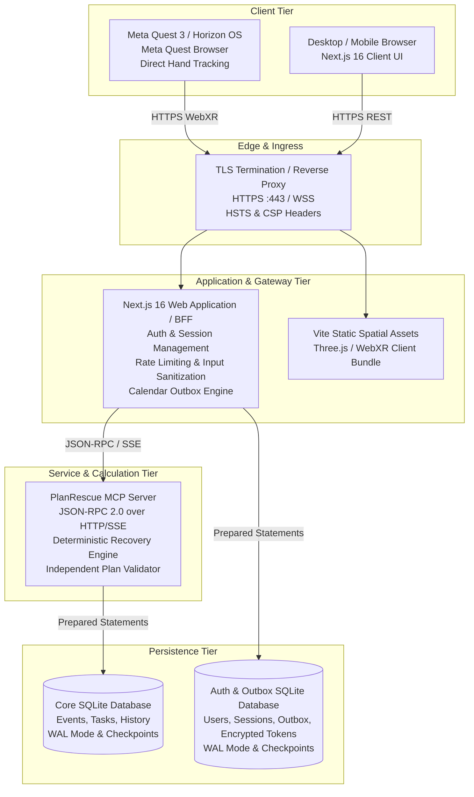

# PlanRescue Spatial — Deployment & System Architecture
**Meta VR Start Developer Competition 2026 — Track: Productivity**
**Product:** PlanRescue Spatial  
**Tagline:** Your Day Changed. Reshape It With Your Hands.

---

## 1. System Overview & Component Topology

PlanRescue Spatial operates as an integrated multi-tier productivity recovery architecture:

---

## 2. Component Roles & Separation of Concerns

### 2.1 Spatial Client (`apps/vr`)
- **Technology:** Three.js 0.185, TypeScript, Meta Immersive Web SDK (IWSDK) 1.1.0, Vite.
- **Role:** Renders the 3D Productivity Studio in WebXR `immersive-vr` mode. Handles optical hand tracking, gesture hysteresis (pinch/grab), 3-zone layout (Timeline, Assistant, Comparison/Action), and accessibility controls.
- **Security:** Static bundle; never holds database connections, API secrets, or server private keys. Communicates exclusively with the Next.js API via cookie or Bearer session tokens.

### 2.2 Next.js BFF & Web App (`apps/web`)
- **Technology:** Next.js 16 (App Router), React 19, TypeScript.
- **Role:** The authoritative multi-tenant gateway. Enforces user session authentication, rate limiting (Sliding Window), input sanitization against prompt injection, calendar account synchronization, and external calendar outbox reconciliation.
- **Security:** Enforces CSP, HSTS, secure cookies (`HttpOnly`, `SameSite=Lax`), and AES-256-GCM encryption of third-party calendar OAuth tokens at rest.

### 2.3 Model Context Protocol Server (`apps/mcp-server`)
- **Technology:** Node.js, TypeScript, Model Context Protocol SDK.
- **Role:** Exposes deterministic scheduling and recovery calculation tools (`get_schedule`, `get_tasks`, `analyze_conflicts`, `propose_recovery_plan`, `validate_recovery_plan`, `save_recovery_plans`, `get_recovery_plans`, `approve_recovery_plan`, `reject_recovery_plan`, `apply_approved_plan`, `get_action_history`).
- **Safety Invariant:** All calculations are strictly deterministic. AI agents interpret user requests and suggest parameters; deterministic engine computes; validator verifies; users approve; system executes.

### 2.4 SQLite Persistence Layer
- **Databases:**
  1. `data/planrescue.sqlite`: Core business data (events, tasks, recovery plans, action history).
  2. `data/planrescue-auth.sqlite`: Multi-tenant identities, sessions, preferences, external calendar accounts, and outbox queue.
- **Readiness:** Both databases run with `PRAGMA journal_mode = WAL;`, `PRAGMA synchronous = NORMAL;`, `PRAGMA foreign_keys = ON;`, and `PRAGMA busy_timeout = 5000;`.

---

## 3. Network & Security Architecture

1. **HTTPS / Secure Context Requirement**: WebXR device APIs (`navigator.xr.requestSession('immersive-vr')`) are strictly gated by modern browsers to secure contexts (`https://` or `http://localhost`). In staging and production, TLS 1.3 termination is mandatory.
2. **Permissions Policy**: `Permissions-Policy: xr-spatial-tracking=(self)` is enforced to authorize hand and head tracking while preventing unauthorized third-party iframe snooping.
3. **CORS & Origin Isolation**: The API routes allow credentials only from trusted frontend origins configured via `ALLOWED_ORIGINS`.
4. **Token Encryption at Rest**: Access and refresh tokens for Google Calendar and Microsoft Outlook are encrypted using AES-256-GCM with PBKDF2/scrypt-derived keys. Plaintext tokens are never stored in SQLite.

---

## 4. Scalability & Availability Profile

| Dimension | Characteristic | Implementation |
|---|---|---|
| **Concurrency** | Multi-Tenant with WAL | SQLite WAL mode permits concurrent readers without blocking writers. |
| **Recovery Engine** | Stateless Calculation | Deterministic engine computes solutions in memory in < 15ms. |
| **Outbox Resilience** | At-Least-Once Delivery | External calendar updates queue in `external_sync_outbox` with exponential retry. |
| **Failover / Backups** | Atomic Online Snapshots | `PRAGMA wal_checkpoint(TRUNCATE)` ensures point-in-time consistent backups. |
